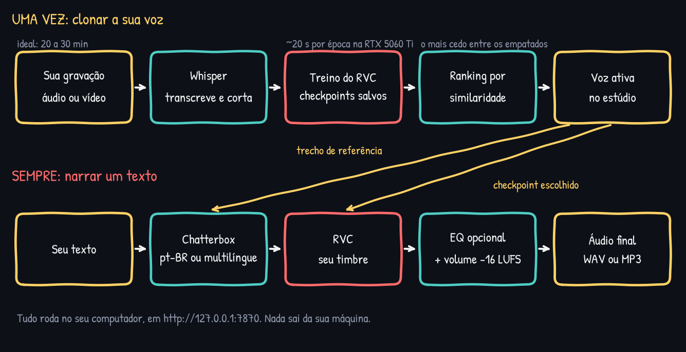
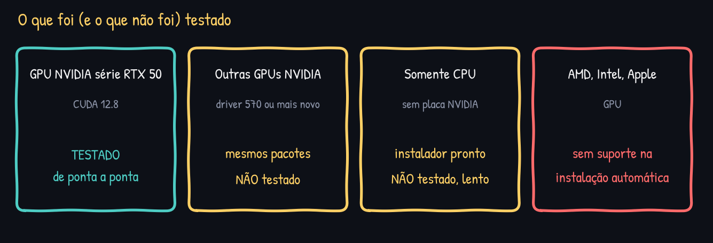
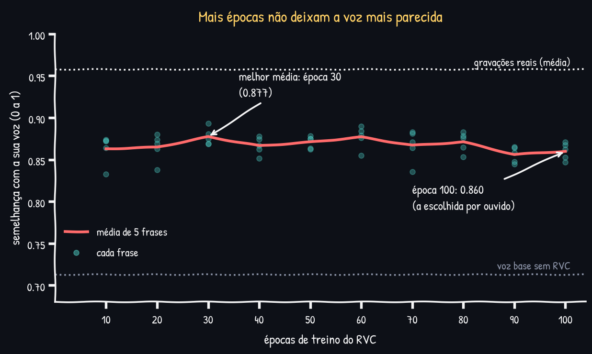
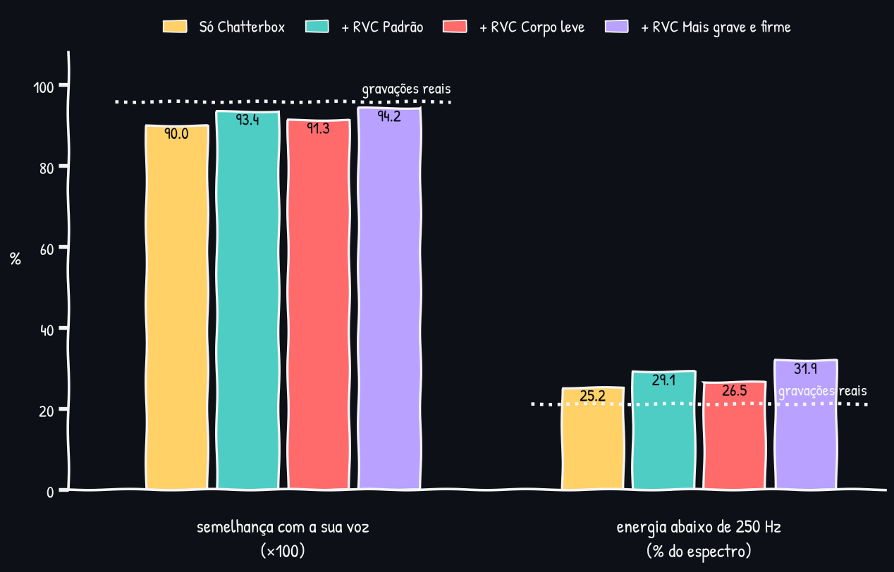

# Wolf Voice Studio

Clone a voz que você já tem e use ela para narrar vídeos. Você envia uma gravação, o app instala tudo, transcreve, treina, compara os resultados e te dá um estúdio para gerar narração em português e inglês. Também funciona por linha de comando, para encaixar num pipeline de vídeo.



> English summary at the [end of this file](#english).

## Começando

Precisa só de Python 3.11+ no PATH. O app instala o resto (ffmpeg, RVC, Chatterbox, modelos).

```
git clone https://github.com/IsmarWolf/WolfsVoiceCloning
cd WolfsVoiceCloning
studio.bat            # Windows
./studio.sh           # Linux
```

Abra http://127.0.0.1:7870. A aba **Clonar voz** detecta seu hardware, instala, recebe sua gravação (qualquer áudio ou vídeo) e faz o resto. A aba **Estúdio** é onde você digita o texto e gera a voz.

Depois de treinada, por linha de comando:

```
python narrate.py --lang pt --text "Olá, pessoal!" --out vo.wav --json
```

## O que o app faz sozinho

1. **Instala** ambientes Python isolados (`uv`, Python 3.12), ffmpeg e os modelos, em versões fixadas de cada projeto.
2. **Prepara a gravação**: converte, corta em trechos de 5 a 15 s e transcreve com faster-whisper.
3. **Treina o RVC** (opcional, melhora a semelhança do timbre) e guarda vários checkpoints.
4. **Escolhe o checkpoint**: gera a mesma frase com cada um e compara com a sua voz real.
5. **Gera**: o Chatterbox multilíngue (modelo pt-BR) fala o texto usando um trecho seu como referência, e o RVC converte o timbre.

## Perfis de hardware



| Perfil | Para | Situação |
|---|---|---|
| `cuda` | Placas NVIDIA (CUDA 12.8, driver 570+) | **Testado de ponta a ponta** numa RTX 5060 Ti (série 50), Windows 11. Outras placas NVIDIA usam os mesmos pacotes, mas **não foram testadas**. |
| `cpu` | PCs sem NVIDIA | Segue os requisitos oficiais para CPU, mas **não foi testado num PC só com CPU**. Espere minutos por frase e horas de treino. O app sugere só Chatterbox, sem RVC. |

AMD, Intel e Apple não têm instalação automática.

## Como o checkpoint é escolhido



Cada ponto é a semelhança (0 a 1) entre uma frase gerada e a média das gravações reais, medida com o codificador de voz do Chatterbox. O app escolhe o **checkpoint mais cedo** que fique a menos de 0,01 do melhor, para não treinar demais.

Leia o gráfico com cuidado:

- A métrica mede **só timbre**. Ela não diz se a voz soa natural, nem se ritmo e emoção estão bons.
- No caso real mostrado, a diferença entre as épocas é pequena (cerca de 0,86 a 0,88).
- A época 100 foi escolhida **por ouvido** e tem média um pouco menor que as épocas 30 e 60 nesta métrica. Ouvido e métrica discordam, e a decisão final é sua: a aba mostra players e deixa trocar.
- Quem escreveu este README não consegue ouvir áudio. Os números são os únicos fatos aqui.

## Profundidade e configurações salvas



Se a voz soa suave demais, o Estúdio tem controles de **Graves, Corpo, Presença e Densidade**, aplicados só no arquivo final, e três presets: *Padrão*, *Corpo leve* e *Mais grave e firme*. Dá para comparar lado a lado com e sem ajuste.

O gráfico mostra a semelhança medida e a fração de energia em baixas frequências. A voz gerada já tem **mais** energia grave que as gravações reais, e os presets aumentam isso. Então eles mudam o gosto, não corrigem uma falta medida. Se ficou melhor, só o seu ouvido diz.

Em *Minhas configurações* você salva, carrega e apaga conjuntos de ajustes com nome, e o app lembra os últimos usados.

## Privacidade

Sua voz nunca vai para o git. `voices/`, `models/`, `settings.json`, `presets.json` e `tools/` estão no `.gitignore`, e o repositório só tem código e texto. Tudo roda na sua máquina; só os modelos base são baixados (Hugging Face e GitHub).

## Organização

```
studio.py, ui/            o app (servidor local + interface)
portable.py               caminhos e configuração, nada fixo
setup_manager.py          detecção de hardware e instalação
voices.py                 vozes, clonagem e escolha de checkpoint
narrate.py                texto -> arquivo de voz (use --json em pipelines)
train_rvc.py              treino do RVC sem interface
compare_checkpoints.py    renderiza frases de cada checkpoint
engines/                  servidores persistentes do Chatterbox e do RVC
docs/                     figuras (make_figures.py gera as imagens)
01_RECORDING_CHECKLIST.md como gravar
02_TRAINING_GUIDE.md      guia manual e licenças
```

Para refazer as figuras: `pip install matplotlib numpy` e `python docs/make_figures.py`. Os números ficam em `docs/figures_data.json`, só valores, sem áudio.

## Licenças

Chatterbox (MIT), RVC (MIT), faster-whisper (MIT). GPT-SoVITS e F5-TTS são opcionais e o app não instala. Detalhes em `02_TRAINING_GUIDE.md`. Clone apenas a sua própria voz, ou a de quem autorizou.

---

## English

**Wolf Voice Studio** clones your own voice for video narration (Portuguese and English). Upload a recording; the app installs everything, transcribes and cuts it, trains RVC, ranks checkpoints against your real voice and gives you a studio to generate speech. `narrate.py --json` is there for video pipelines.

**Install:** Python 3.11+ on PATH, run `studio.bat` (Windows) or `./studio.sh` (Linux), open http://127.0.0.1:7870.

| Profile | Status |
|---|---|
| `cuda` (NVIDIA, CUDA 12.8, driver 570+) | Tested end to end on one RTX 5060 Ti, Windows 11. Other NVIDIA cards: same wheels, **not tested**. |
| `cpu` | **Not tested on a real CPU-only PC.** Expect minutes per sentence and hours of training; the app suggests Chatterbox only. |

AMD, Intel and Apple GPUs are not supported by the automatic setup.

**What the charts do and don't say:** the similarity score measures timbre only, not naturalness. On the author's voice the checkpoints score within about 0.86-0.88, and the one chosen by ear (epoch 100) scores slightly below epochs 30 and 60. The depth presets raise low-frequency energy, which was already above that of the real recordings, so they are a matter of taste, not a measured fix. The assistant that wrote this cannot listen to audio.

**Privacy:** voices, models, settings and presets are git-ignored; only code and text are in the repository.
